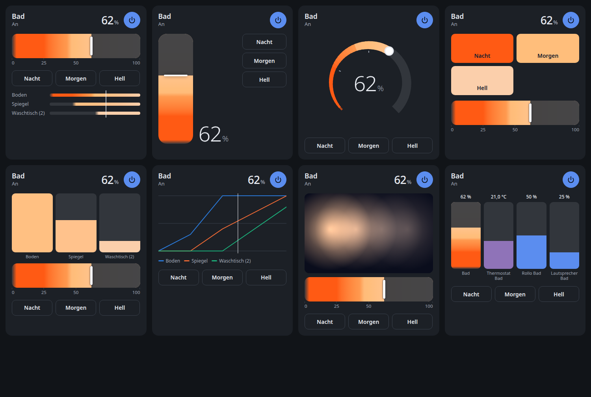
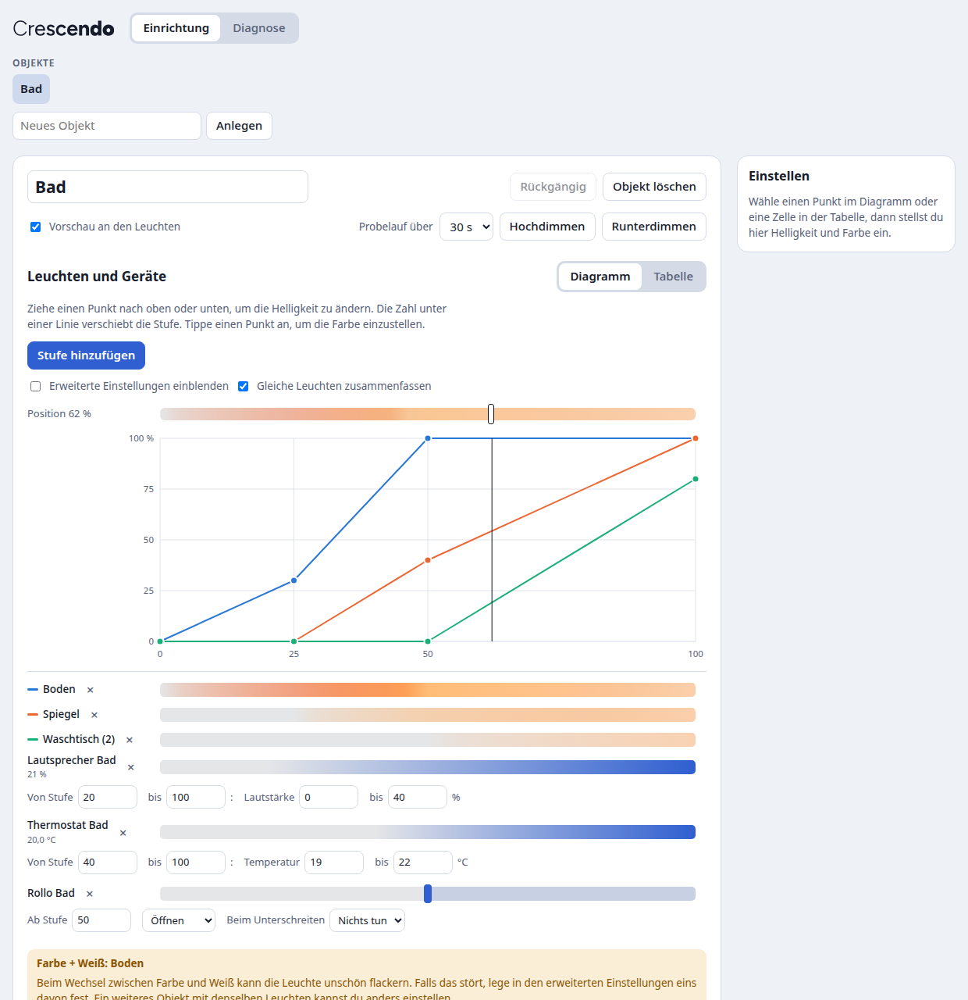

# Cloudless Crescendo

Eine Home-Assistant-Integration, die mehrere Leuchten als ein Objekt dimmt, entlang einer Abfolge, die du selbst festlegst. In jeder Stufe auf einer Skala von 0 bis 100 hat jede Leuchte ihre eigene Helligkeit und Farbe. Dazwischen wird fließend überblendet. Beim Runterdimmen läuft dieselbe Abfolge rückwärts.

[English version](README.md)





## Was du bekommst

- **Ein Objekt, viele Leuchten.** In Home Assistant ist das Objekt ein normales Licht. Kacheln, Sprachbefehle („50 Prozent“) und Automationen funktionieren wie gewohnt, und seine Helligkeit ist die Position auf der Skala.
- **Nichts Verstecktes.** Jede Leuchte hat in jeder Stufe einen Wert. Du siehst alle im Diagramm oder in der Tabelle und änderst sie dort.
- **Native Überblendungen.** Zeitgesteuertes Dimmen nutzt die eigenen Überblendungen der Leuchten über `light.turn_on`. Es läuft dadurch weich und hängt nicht daran, was Home Assistant gerade sonst tut. Nur ein von Hand gezogener Slider sendet Werte in Echtzeit, standardmäßig 4 pro Sekunde.
- **Andere Geräte auf derselben Skala.** Lautstärke und Temperatur können einem Bereich der Skala folgen. Rollos, Heizung oder Musik können an einer Schwelle starten oder stoppen, auf Wunsch mit einer Gegenaktion darunter.
- **Eine Karte, acht Designs.** Raumverlauf, Hochkant, Drehregler, Szenen, Säulen für einzelne Leuchten, Diagramm, ein Foto deines Raums mit Lichtpunkten und ein Mischpult für mehrere Geräte. Jedes Design kann die Säulen aller Leuchten in einem Fenster öffnen, über einen Knopf oder durch Tippen auf die Karte. Die Karte funktioniert auch mit anderen Leuchten, Klima, Rollos, Medienplayern, Lüftern, Zahlenwerten und reinen Anzeige-Sensoren.
- **Diagnose.** Reaktionszeiten und Fehler aus dem normalen Betrieb, dazu ein Verbindungstest, der vor dem Start nachfragt.
- **Deutsch und Englisch.**

## Installieren

**Home Assistant 2026.11 oder neuer (Marketplace)**

[](https://my.home-assistant.io/redirect/hacs_repository/?owner=MadisonMedia&repository=cloudless-crescendo&category=integration)

1. Wähle den Button oben, oder gehe zu **Einstellungen → Marketplace** und füge `https://github.com/MadisonMedia/cloudless-crescendo` per Link hinzu. Dafür braucht es eine Verbindung zu GitHub, nach der der Marketplace fragt.
2. Solange Crescendo im Beta-Stadium ist, schalte beim Repository den Schalter für Vorabversionen (Pre-release) ein und installiere es dann. Ohne den Schalter bekommst du den neuesten Stand des Hauptzweigs statt einer nummerierten Version.

**Home Assistant 2026.10 oder älter (HACS)**

1. Öffne in HACS das Menü oben rechts und wähle **Benutzerdefinierte Repositories**.
2. Füge `https://github.com/MadisonMedia/cloudless-crescendo` mit dem Typ **Integration** hinzu.
3. Installiere **Cloudless Crescendo** und starte Home Assistant neu.

Benötigt Home Assistant 2026.2 oder neuer.

## Das erste Objekt anlegen

[](https://my.home-assistant.io/redirect/config_flow_start/?domain=cloudless_crescendo)

Gehe zu **Einstellungen → Geräte & Dienste → Integration hinzufügen → Cloudless Crescendo**, gib einen Namen ein und wähle die Leuchten. Danach erscheint **Crescendo** in der Seitenleiste. Die Seite erreichst du auch über **Konfigurieren** beim Objekt und aus dem Karten-Editor; unter **Verhalten** kannst du den Eintrag mit **Diese Einstellungsseite aus der Seitenleiste entfernen** loswerden und später wieder aufnehmen.

## Ein Objekt einrichten

Öffne **Crescendo** in der Seitenleiste.

1. Wähle oben das Objekt, oder **Neues Objekt**, und gib ihm einen Namen.
2. Unter **Leuchten und Geräte** suchst du Leuchten und Geräte nach Name, Raum oder Art und fügst sie hinzu; Leuchten sind vorausgewählt. Je Leuchte wählst du, was sie zeigt: Weißtöne, Farben oder beides. Unter **Mehr** stehen Überblendung und Slider-Verhalten. Gleich eingestellte Leuchten schlägt die Seite als Gruppe vor, mit einem Anzeigenamen; mit **Leuchten gruppieren** bildest du Gruppen selbst.
3. Unter **Stufen** stellst du das **Tempo** ein. **Vorlagen** geben allen Leuchten eine fertige Form, etwa nacheinander von warm zu neutral oder wie ein anderes Objekt. Ziehe die Punkte im Diagramm, um die Helligkeit jeder Leuchte einzustellen, und tippe einen Punkt an: Seine Einstellungen öffnen sich direkt daneben, mit Balken für Helligkeit, Weißton, Farbe und Sättigung; das Häkchen oder ein Tipp daneben schließt sie. Darunter stehen die Geräte mit ihrem Verlauf oder ihrer Schwelle. Die Zahl unter einer Linie verschiebt die Stufe. Änderungen werden automatisch gespeichert und an den Leuchten gezeigt, solange **Vorschau an den Leuchten** an ist.
4. Lege **Standard-Buttons** an. Neue Karten übernehmen sie als Vorlage. **Ein/Aus** steht als erster Eintrag dabei und legt fest, worauf das Objekt einschaltet.
5. Unter **Verhalten** stellst du den Slider ein.

**Exportieren** speichert ein Objekt als Datei, **Importieren** legt daraus ein neues an oder ersetzt das gewählte.

Die Leiste am unteren Rand zeigt die Position, schaltet die Vorschau an den Leuchten und startet Probeläufe.

Um die Karte zu einem Dashboard hinzuzufügen, bearbeitest du das Dashboard, fügst eine Karte hinzu und wählst **Crescendo**. Im Karten-Editor stellst du Design, Reglerfarbe, Buttons, das Öffnen der einzelnen Leuchten und mehr ein.

## Einstellungen pro Leuchte

Was eine Leuchte zeigt, steht direkt in ihrer Zeile; Überblendung und Slider-Verhalten unter **Mehr**. Bei einer Gruppe stehen dort auch ihr Anzeigename und ihre Leuchten.

| Einstellung | Möglichkeiten |
| --- | --- |
| Farbe | Nur an/aus, Nur dimmen, Weißtöne, Farben, Farben und Weißtöne. Angeboten wird nur, was die Leuchte kann. |
| Überblendung | **Weich** (Standard): Die Leuchte überblendet selbst. **Pünktlich**: Falls diese Leuchte zu spät ihr Ziel erreicht, probiere diese Einstellung. Sie läuft dann in kurzen Schritten und kann stärker ruckeln. |
| Am Slider | Automatisch, Gleiten oder Direkt. |

Bei Farbe + Weiß kann eine Leuchte beim Wechsel zwischen beidem flackern, je nach Firmware. Falls das stört, wähle eins davon. Ein weiteres Objekt mit denselben Leuchten kannst du anders einstellen.

## Aktionen

Das Objekt ist ein Licht, also funktioniert `light.turn_on` mit `brightness_pct` und `transition`. Eine einzelne Überblendung ist durch den Wertebereich von Matter auf rund 1 Stunde 49 Minuten begrenzt, längere Fades teilt Crescendo selbst auf.

| Aktion | Zweck |
| --- | --- |
| `cloudless_crescendo.fade_to` | Über eine beliebige Dauer auf eine Position fahren. Ohne Dauer dauert es seinen Anteil am Tempo des Objekts. Das optionale Feld `source` nennt den Aufrufer in den Attributen des Objekts, und `devices: false` lässt andere Geräte bei diesem Befehl unberührt. |
| `cloudless_crescendo.stop` | Ein laufendes Dimmen stoppen und die Leuchten lassen, wie sie gerade sind. Nimmt das optionale Feld `source` wie `fade_to`. |
| `cloudless_crescendo.press_button` | Einen der Standard-Buttons über seinen Namen ausführen. |
| `cloudless_crescendo.set_on_position` | Die Position festlegen, die beim Einschalten ohne Wert gilt, zum Beispiel nach Tageszeit. Sie übersteht einen Neustart. Ohne Position gilt wieder die Einstellung des Objekts. |
| `cloudless_crescendo.reset_color` | Eine von Hand gewählte Farbe beenden, auch eigene Farben einzelner Leuchten, und zu den Farben der Stufen zurückkehren. |

```yaml
# In 30 Minuten auf 80 %, zum Beispiel als Aufwachlicht
action: light.turn_on
target:
  entity_id: light.bad
data:
  brightness_pct: 80
  transition: 1800
```

## Wie es sich verhält

- Änderst du während des Dimmens eine einzelne Leuchte von Hand, fällt nur diese Leuchte heraus. Beim nächsten Befehl an das Objekt ist sie wieder dabei.
- Gehört eine Leuchte zu mehreren Objekten, gilt der letzte Befehl, und das Dimmen des anderen Objekts stoppt.
- Leuchten, die offline waren, holen ihren Stand nach, wenn sie zurückkommen. Das Dimmen läuft nach einem Neustart von Home Assistant weiter, und eine gewählte Farbe bleibt.
- Eine Farbe, die du in der normalen Lichtsteuerung des Objekts oder auf der Karte wählst, überschreibt die Farben der Stufen, bis du ausschaltest oder auf der Karte **Zurücksetzen** wählst. Leuchten ohne Farbe behalten ihr Weiß. Auf der Karte öffnet der Name einer Leuchte ihre Einstellungen: Helligkeit sowie Weißton, Farbe und Sättigung, soweit ihr Modus das erlaubt. Eine zusammengefasste Säule listet dort ihre Leuchten, jede mit eigenen Einstellungen. **Zurücksetzen** bringt einzelne Leuchten und eine gewählte Farbe zurück zu den Stufen.
- Überblendungen ohne Dauer dauern ihren Anteil an der Zeit für 0 bis 100 % (**Tempo** unter **Stufen** auf der Einrichtungsseite): von 80 auf 100 % ein Fünftel davon. Das gilt für Buttons, Ein- und Ausschalten, Tippen auf den Regler einer Karte sowie Kacheln und Sprachbefehle. Eine Karte kann ein eigenes Tempo haben. Eine angegebene Dauer, etwa aus einer Automation, gilt genau.
- Eine Schwelle löst einmal aus: beim Slider erst beim Loslassen, bei zeitgesteuertem Dimmen beim Überschreiten.

## Für andere Integrationen

Andere Integrationen, zum Beispiel Cloudless Maestro, erkennen an den Attributen des Objekts, welcher Befehl seinen aktuellen Zustand bestimmt. Die Attribute bleiben bei allen Zuständen eines Befehls gleich, auch beim Fortschritt eines langen Dimmens, und sie überstehen einen Neustart. Diese Zustände behalten auch den Kontext des Befehls.

| Attribut | Inhalt |
| --- | --- |
| `command` | `switch_on`, `set`, `switch_off` oder `stop` |
| `command_source` | Das Feld `source` aus `fade_to` oder `stop`, sonst `null` |
| `command_user_id` | Der Benutzer in Home Assistant, der den Befehl gegeben hat, sonst `null` |
| `command_at` | Wann der Befehl kam, in ISO 8601 |
| `external_on_position` | Die mit `set_on_position` gesetzte Position, sonst `null` |
| `crescendo_api` | Die Version dieser Attribute und Felder, derzeit `1` |

- Einschalten ohne Wert ist `switch_on`, auch mit einer Farbe. Eine Helligkeit, ein Button, `fade_to` über 0 oder ein Ziehen am Slider einer Karte ist `set`. Ausschalten, ein Ziel von 0 oder ein Ziehen, das bei 0 endet, ist `switch_off`.
- Eine Farbe allein, einzelne Leuchten, `set_on_position` und geänderte Einstellungen lassen die Attribute, wie sie sind. Eine gewählte Farbe zeigt `color_override`, einzelne Leuchten zeigt `deviating`: von Hand gedimmte zusätzlich `deviating_brightness`, solche mit eigener Farbe zusätzlich `deviating_color`.
- Ein Befehl, der nichts ändert, lässt sie ebenfalls stehen: Einschalten eines Objekts, das an ist oder hochdimmt, `stop` ohne laufendes Dimmen und `reset_color` ohne gewählte Farbe.
- Übernimmt ein anderes Objekt die Leuchten, stoppt das Dimmen dieses Objekts mit `command: stop` und der Herkunft des Befehls, der sie übernommen hat.
- Mit `devices: false` bleiben Schwellen und mitlaufende Werte, wo sie sind. Der nächste Befehl mit Geräten holt sie nach: Eine Schwelle löst einmal aus, wenn das Ziel auf ihrer anderen Seite liegt, und ein mitlaufender Wert läuft von dem Wert weiter, den er zuletzt bekam.

## Thread und Matter

Der Matter-Server sendet seine Befehle mit Abstand, und ein Thread-Netz teilt seine Kapazität unter allen Leuchten. Das kann keine Integration ändern. Bei Thread sind rund 12 bis 16 Befehle pro Sekunde für alle Leuchten zusammen zu erwarten. Deshalb nutzt zeitgesteuertes Dimmen native Überblendungen, und ein Slider sendet pro Leuchte immer nur den neuesten Wert. Falls ein Slider ruckelt, verringere seine Aktualisierungen pro Sekunde unter **Weitere Einstellungen**.

Manche Leuchten springen beim Wechsel zwischen Farbe und Weiß. Das liegt an ihrer Firmware.

## Entwicklung

```bash
pip install -r requirements_test.txt ruff
pytest -q
ruff check .
```

`tests/frontend/harness.html` führt die echte Karte und Einrichtungsseite gegen ein simuliertes Home Assistant aus. Liefere das Hauptverzeichnis des Repositorys mit einem beliebigen lokalen Webserver aus und öffne diese Datei.

## Lizenz

MIT
