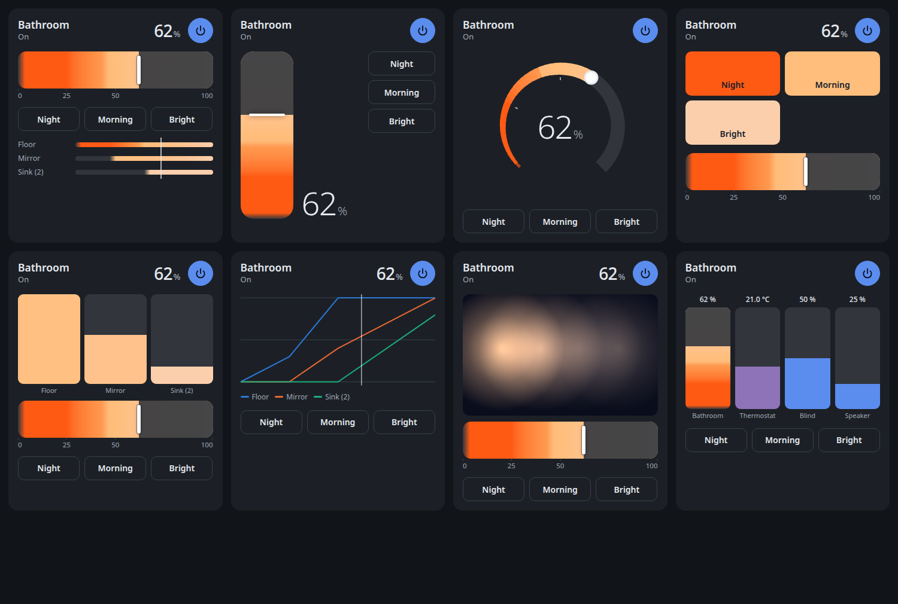
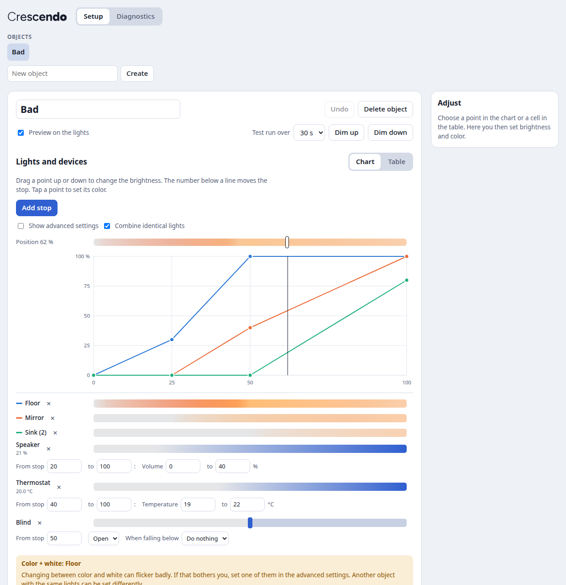

# Cloudless Crescendo

A Home Assistant integration that dims several lights as one object, along a sequence you design. At every stop on a scale from 0 to 100, each light has its own brightness and color. In between, the lights blend smoothly. Dimming down runs the same sequence in reverse.

[Deutsche Version](README.de.md)





## What you get

- **One object, many lights.** In Home Assistant the object is a normal light. Tiles, voice commands ("50 percent") and automations work as usual, and its brightness is the position on the scale.
- **Nothing hidden.** Every light has a value at every stop. You see all of them in a chart or a table and can change them there.
- **Native fades.** Timed fades use the lights' own transitions through `light.turn_on`, so they run smoothly and don't depend on Home Assistant staying busy. Only a slider dragged by hand sends values in real time, 4 per second by default.
- **Other devices on the same scale.** Volume and temperature can follow a range of the scale. Blinds, heating or music can start or stop at a threshold, with an optional opposite action below it.
- **One card, eight designs.** Room gradient, upright fader, dial, scenes, columns for single lights, chart, a photo of your room with light points, and a mixer for several devices. Any design can open the columns of all lights in a window, by a button or a tap on the card. The card also works with other lights, climate, covers, media players, fans, number entities and read-only sensors.
- **Diagnostics.** Reaction times and failures from normal operation, plus a connection test that asks before it runs.
- **German and English.**

## Install

**Home Assistant 2026.11 or newer (Marketplace)**

[](https://my.home-assistant.io/redirect/hacs_repository/?owner=MadisonMedia&repository=cloudless-crescendo&category=integration)

1. Select the button above, or go to **Settings → Marketplace** and add `https://github.com/MadisonMedia/cloudless-crescendo` with **Add from link**. This needs a connection to GitHub, which the Marketplace asks for.
2. While Crescendo is in beta, turn on the **Pre-release** switch for the repository, then install it. Without the switch you get the newest state of the main branch instead of a numbered version.

**Home Assistant 2026.10 or older (HACS)**

1. In HACS, open the menu at the top right and choose **Custom repositories**.
2. Add `https://github.com/MadisonMedia/cloudless-crescendo` with the type **Integration**.
3. Install **Cloudless Crescendo** and restart Home Assistant.

Requires Home Assistant 2026.2 or newer.

## Create your first object

[](https://my.home-assistant.io/redirect/config_flow_start/?domain=cloudless_crescendo)

Go to **Settings → Devices & services → Add integration → Cloudless Crescendo**, enter a name and choose the lights. **Crescendo** then appears in the sidebar. The page is also reachable through **Configure** on the object and from the card editor; under **Behavior**, **Remove this settings page from the sidebar** takes the entry away, and it can be put back later.

## Set up an object

Open **Crescendo** in the sidebar.

1. Choose the object at the top, or **New object**, and name it.
2. Under **Lights**, add its lights and choose for each what it shows: white tones, colors or both. **More** holds the fade and slider behavior.
3. Drag the points in the chart to set each light's brightness, and tap a point: its settings open right beside it, with bars for brightness, white tone, color and saturation. The number below a line moves that stop. Changes are saved automatically and shown on the lights while **Preview on the lights** is on.
4. Add **Standard buttons**. New cards take them as a template.
5. Under **Devices**, search a speaker, a thermostat or a blind by name, room or kind and let it follow the scale with a **Course** or a **Threshold**. Under **Behavior**, set the speed, switching on and the slider.

The bar at the bottom shows the position, switches the preview on the lights and starts test runs.

To add the card to a dashboard, edit the dashboard, add a card and choose **Crescendo**. The card editor offers the design, control colors, buttons, how the single lights open, and more.

## Per-light settings

What a light shows stands in its row; the fade and slider behavior under **More**.

| Setting | Options |
| --- | --- |
| Color | On/off only, dimming only, white tones, colors, colors and white tones. Only what the light can do is offered. |
| Fade | **Smooth** (default): the light fades by itself. **On time**: if a light reaches its target too late, try this setting. It then moves in short steps and may stutter more. |
| On the slider | Automatic, glide or direct. |

Color + white can flicker when a light changes between the two, depending on its firmware. If that bothers you, choose one of them. Another object with the same lights can be set differently.

## Actions

The object is a light, so `light.turn_on` with `brightness_pct` and `transition` works. A single light transition is limited to about 1 hour 49 minutes by the Matter protocol's range, and Crescendo splits longer fades for you.

| Action | Purpose |
| --- | --- |
| `cloudless_crescendo.fade_to` | Move to a position over any duration. Without a duration, the fade takes its share of the object's speed. The optional `source` names the caller in the object's attributes, and `devices: false` leaves other devices alone for this command. |
| `cloudless_crescendo.stop` | Stop a running fade and keep the lights as they are. Takes the optional `source` like `fade_to`. |
| `cloudless_crescendo.press_button` | Run one of the standard buttons by name. |
| `cloudless_crescendo.set_on_position` | Set the position used when switching on without a value, for example by time of day. It survives a restart. Without a position, the object's own setting applies again. |
| `cloudless_crescendo.reset_color` | End a color chosen by hand, also single lights' own colors, and return to the stops' colors. |

```yaml
# In 30 minutes to 80 %, for example as a wake-up light
action: light.turn_on
target:
  entity_id: light.bathroom
data:
  brightness_pct: 80
  transition: 1800
```

## How it behaves

- If you change a single light by hand during a fade, only that light drops out. It rejoins at the next command to the object.
- If a light belongs to several objects, the last command wins and the other object's fade stops.
- Lights that were offline catch up when they return. Fades continue after a restart of Home Assistant, and a chosen color stays.
- A color chosen in the object's normal light controls or on the card overrides the stops' colors until you switch off or choose **Reset** on the card. Lights without color keep their white. On the card, a light's name opens its settings: brightness, and white tone, color and saturation as far as its mode allows. A combined column lists its lights there, each with its own settings. **Reset** brings single lights and a chosen color back to the stops.
- Fades without a duration take their share of the time set for 0 to 100 % (**Speed** under **Behavior** on the setup page): from 80 to 100 % a fifth of it. This applies to buttons, switching on and off, taps on a card's slider, and tiles or voice commands. A card can set its own speed. A given duration, for example from an automation, counts exactly.
- A threshold fires once: on a slider when you let go, on a timed fade when it is crossed.

## For other integrations

Other integrations, for example Cloudless Maestro, can tell from the object's attributes which command decides its current state. The attributes stay the same for every state that belongs to a command, including the progress of a long fade, and they survive a restart. These states also keep the command's context.

| Attribute | Content |
| --- | --- |
| `command` | `switch_on`, `set`, `switch_off` or `stop` |
| `command_source` | The `source` sent with `fade_to` or `stop`, otherwise `null` |
| `command_user_id` | The Home Assistant user who gave the command, otherwise `null` |
| `command_at` | When the command was given, in ISO 8601 |
| `external_on_position` | The position set with `set_on_position`, otherwise `null` |
| `crescendo_api` | The version of these attributes and fields, currently `1` |

- Switching on without a value is `switch_on`, also with a color. A brightness, a button, `fade_to` above 0 or a drag on a card's slider is `set`. Switching off, a target of 0 or a drag that ends at 0 is `switch_off`.
- A color alone, single lights, `set_on_position` and changed settings leave the attributes as they are. A chosen color shows in `color_override`, single lights in `deviating`: those dimmed apart also in `deviating_brightness`, those with a color of their own also in `deviating_color`.
- A command that changes nothing leaves them too: switching on an object that is on or dimming up, `stop` without a fade, and `reset_color` without a chosen color.
- If another object takes the lights, this object's fade stops with `command: stop` and the origin of the command that took them.
- With `devices: false`, thresholds and following values stay where they are. The next command with devices catches up: a threshold acts once if the target lies on its other side, and a following value moves on from the value it last got.

## Thread and Matter

The Matter server spaces its commands, and a Thread network shares its capacity among all lights. No integration can change this. On Thread, expect roughly 12 to 16 commands per second for all lights together. That's why timed fades use native transitions, and why a slider sends each light only its newest value. If a slider stutters, lower its updates per second in **More settings**.

Some lights jump when changing between color and white. That comes from their firmware.

## Development

```bash
pip install -r requirements_test.txt ruff
pytest -q
ruff check .
```

`tests/frontend/harness.html` runs the real card and setup page against an in-memory Home Assistant. Serve the repository's root with any local web server and open that file.

## License

MIT
